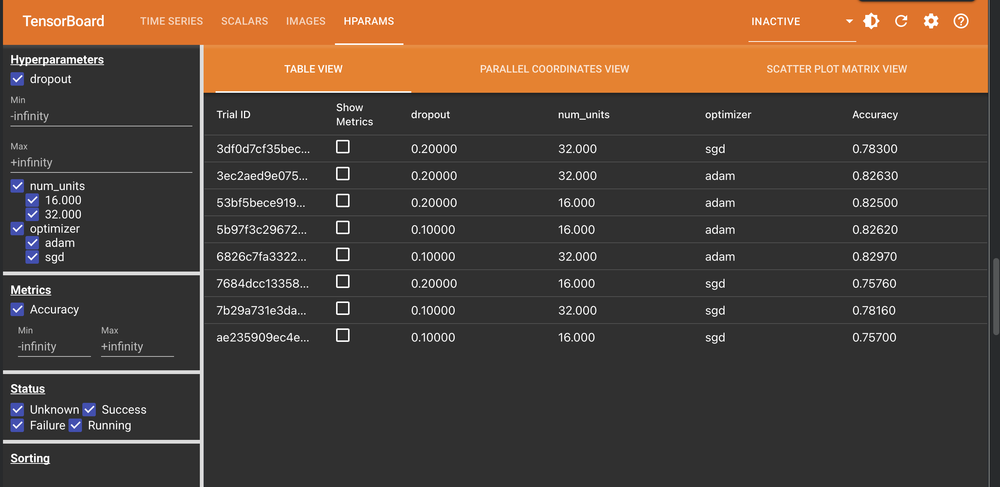
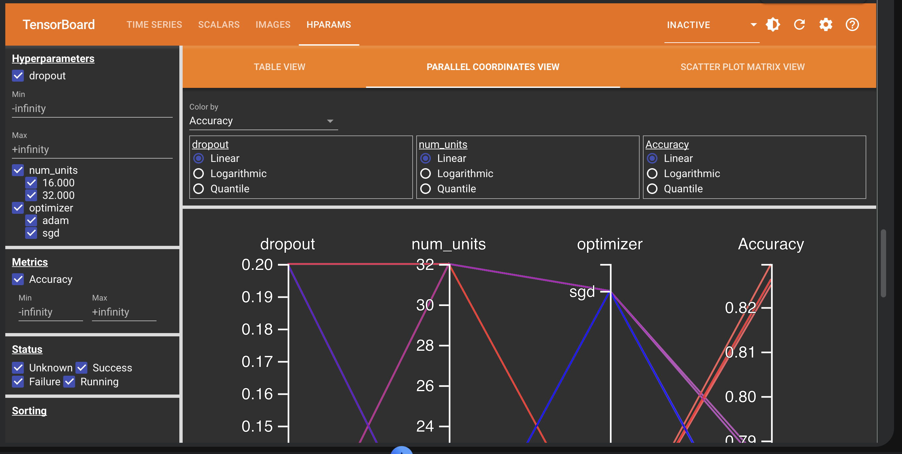
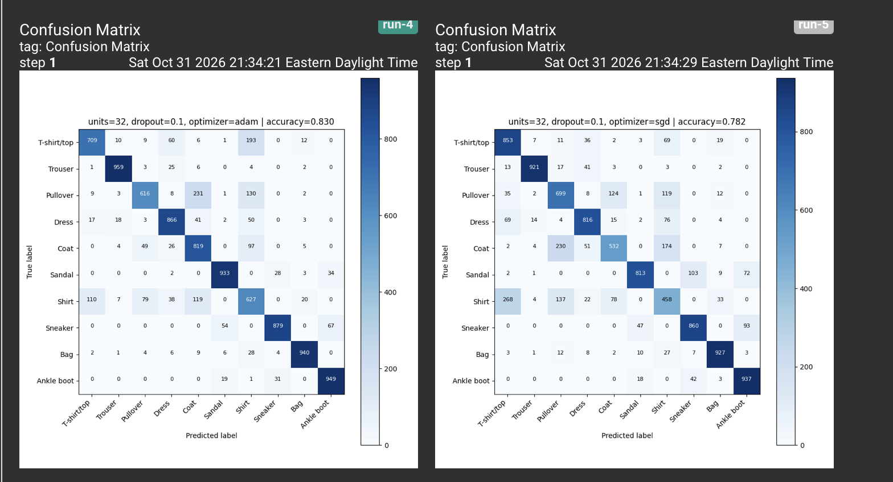
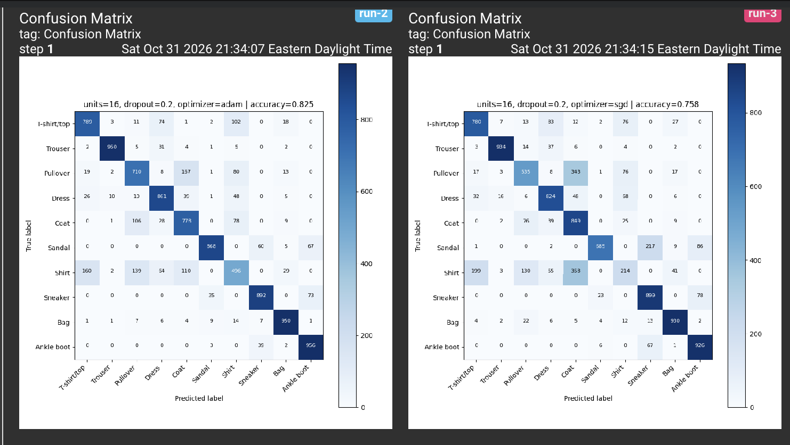

# Lab 4: Hyperparameter Tuning with TensorBoard HParams + Confusion Matrix Logging

Based on the HParams Dashboard lab (`Lab4.ipynb`) from the course repository [raminmohammadi/MLOps](https://github.com/raminmohammadi/MLOps/tree/main/Labs/Tensorflow_Labs/TensorBoard).

## What the original lab does

The lab trains a small neural network to classify Fashion MNIST clothing images into 10 categories. It tries 8 combinations of three hyperparameters (hidden units: 16 or 32, dropout: 0.1 or 0.2, optimizer: adam or sgd) and logs each trial's test accuracy to TensorBoard's HParams dashboard so the trials can be compared.

## What I added

### 1. Confusion matrix logging for every trial (new feature)

Accuracy tells you how often a model is right, but not *which* classes it gets wrong. After each trial, the notebook now:

1. Predicts on all 10,000 test images
2. Builds a confusion matrix with scikit-learn
3. Draws it with matplotlib, titled with that trial's hyperparameters and accuracy
4. Logs it to TensorBoard as an image (`tf.summary.image`), in the same run directory as the trial's accuracy

The result is a new **IMAGES** tab in TensorBoard with one confusion matrix per trial, alongside the existing HParams dashboard.

Code changes: a new helper cell (`CLASS_NAMES`, `plot_confusion_matrix`, `plot_to_image`); `train_test_model` now returns the trained model along with its accuracy; and `run()` builds and logs the matrix. All changed cells are marked with `NEW FEATURE` or `CHANGED` comments.

### 2. About 50x faster training

The original notebook turns on `tf.debugging.experimental.enable_dump_debug_info(..., tensor_debug_mode="FULL_HEALTH")`, which records health statistics for every tensor the model computes. This lab never uses that debug data, so I commented the line out.

| | Before | After |
|---|---|---|
| Time per training step | ~107 ms | ~2 ms |
| All 8 trials (Colab free CPU) | ~29 min | under 1 min |

Accuracy was unaffected.

## Results

| Run | Units | Dropout | Optimizer | Test accuracy |
|---|---|---|---|---|
| run-0 | 16 | 0.1 | adam | 0.8262 |
| run-1 | 16 | 0.1 | sgd | 0.7570 |
| run-2 | 16 | 0.2 | adam | 0.8250 |
| run-3 | 16 | 0.2 | sgd | 0.7576 |
| **run-4** | **32** | **0.1** | **adam** | **0.8297** |
| run-5 | 32 | 0.1 | sgd | 0.7816 |
| run-6 | 32 | 0.2 | adam | 0.8263 |
| run-7 | 32 | 0.2 | sgd | 0.7830 |

The optimizer mattered most: adam beat sgd in every pairing (about 82-83% vs 76-78%). The number of units and the dropout rate made a much smaller difference.

### HParams dashboard

In the parallel coordinates view, each line is one trial. The high-accuracy (red) lines all pass through adam.

### Confusion matrices: what the accuracy score hides

*Left: run-4, the best trial (adam). Right: run-5, the same settings with sgd.*

Even the best model (83% accuracy) is very uneven across classes:

- **Near perfect on visually distinct items:** Trouser 959/1000 correct, Ankle boot 949, Bag 940.
- **Struggles with similar-looking tops:** only 627/1000 shirts were classified correctly (110 predicted as T-shirt/top, 119 as Coat, 79 as Pullover). It also labeled 193 T-shirts as Shirt and 231 pullovers as Coat.
- **Shirt is the lowest-accuracy class in 7 of the 8 trials.** In run-4 it is just behind Pullover.

*Left: run-2 (adam). Right: run-3 (sgd), with the same units and dropout.*

The sgd trials make larger mix-ups. In run-3, 343 pullovers and 353 shirts were predicted as Coat, and 217 sandals were predicted as Sneaker. The adam matrices have a cleaner diagonal, which matches their higher accuracy.

Note: as in the original lab, each trial trains for only 1 epoch, so the adam vs sgd comparison reflects how much each learns in a single pass, not their final quality after full training.

## How to run

1. Click **Open in Colab** at the top of this page.
2. Go to **Runtime → Run all**. The free CPU runtime is enough, and all 8 trials finish in about a minute.
3. In the TensorBoard output at the end, open the **IMAGES** tab for the confusion matrices and the **HPARAMS** tab for the comparison views.

## Files

| File | Description |
|---|---|
| `Lab4.ipynb` | The notebook with both changes, including run outputs |
| `hparams_table.png`, `hparams_parallel.png` | HParams dashboard screenshots |
| `confusion_run4_vs_run5.png`, `confusion_run2_vs_run3.png` | Confusion matrix screenshots |

## Credits

Original lab: Ramin Mohammadi, [MLOps course repository](https://github.com/raminmohammadi/MLOps). Dataset: Fashion MNIST (Zalando Research).
